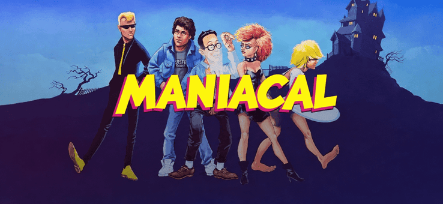
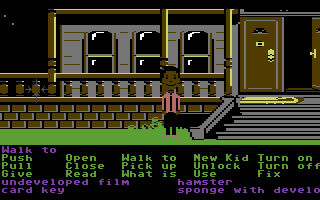
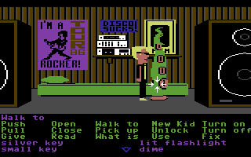
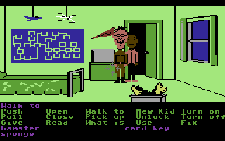
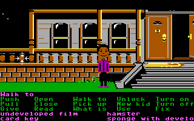
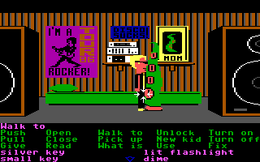
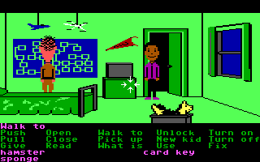
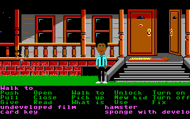
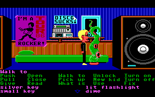
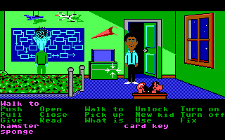

<h1 align="center">

</h1>

<p align="center">
  <a href="https://github.com/jeffnyman/maniacal/actions/workflows/build.yml"></a>
  <a href="https://www.nuget.org/packages/Maniacal"></a>
</p>

<p align="center">
  ✨ Long live the classics.
</p>

**Maniacal** is a C# implementation of the SCUMM interpreter for *Maniac Mansion*. It's a port of the
parts of ScummVM's `engines/scumm` that *Maniac Mansion* uses (SCUMM versions 0, 1 and 2),
restructured as a .NET library on a small host contract of its own, so the same engine runs
headless (as the tests run it) and on the desktop (SDL).

**Maniacal** is not a ScummVM fork and does not aim to run any other SCUMM game. *Zak McKracken* uses
the same engine generations and would come nearly for free, but, at least for right now, it's not a goal.

## Screenshots

Taken by the headless player from the games' own data, at their native 320×200, from saves the
walkthrough tests make along their routes: the same three scenes in each release.

<table>
<tr><th colspan="3">Commodore 64 (V0)</th></tr>
<tr>
<td align="center" valign="top"><br>The front of the mansion</td>
<td align="center" valign="top"><br>Green Tentacle's room</td>
<td align="center" valign="top"><br>Weird Ed's room</td>
</tr>
<tr><th colspan="3">DOS, 1987 (V1)</th></tr>
<tr>
<td align="center" valign="top"><br>The front of the mansion</td>
<td align="center" valign="top"><br>Green Tentacle's room</td>
<td align="center" valign="top"><br>Weird Ed's room</td>
</tr>
<tr><th colspan="3">DOS, 1988, the enhanced release (V2)</th></tr>
<tr>
<td align="center" valign="top"><br>The front of the mansion</td>
<td align="center" valign="top"><br>Green Tentacle's room</td>
<td align="center" valign="top"><br>Weird Ed's room</td>
</tr>
</table>

## Status

All three releases play from the title screen to "You won the game!". The walkthrough tests win
the game every way it can be won (Syd's recording contract, Bernard's call to the Meteor Police,
Wendy's memoirs and Michael's photographs) in each release, and the saves they make along the way,
loaded in ScummVM 2.7.0, show the same screen but for the cursor and the DOS sentence line. The
packages are an alpha: the engine works, but its public API is still to be settled before a 1.0.

| Release | SCUMM version | Data | State |
|---|---|---|---|
| Commodore 64 (1987) | 0 | `maniac1.d64`, `maniac2.d64` disk images | Winnable, with the SID's sound and saves |
| DOS (1987) | 1 | `00.LFL` to `52.LFL`, XOR-encoded | Winnable, with sound and saves |
| DOS, enhanced (1988) | 2 | `00.LFL` to `53.LFL`, XOR-encoded | Winnable, with sound and saves |
| DOS demo (1987) | 1 | `00.MAN` to `49.MAN`, the full release's rooms renamed | Plays its demo through |
| DOS demo (1988) | 2 | `00.LFL` to `53.LFL`, rooms of the 1988 release | Plays its demo through |
| Commodore 64 demo (1987) | 0 | `maniacdemo.d64`, one disk image | Its menu, the self-running demo and the hands-on one |
| NES (1990) | 1 (NES dialect) | `.prg` extracted from the ROM | Not supported; later, if at all |

These are the English releases, and only they are played: a release in another language or for
another platform is named and refused (`maniacal: this is Maniac Mansion (V2, German, DOS), which
Maniacal does not play: it plays only the English releases.`), by the tool and by the library
alike. The DOS demos run themselves, as they were made to, from the title through the mansion to
the Edisons' lab; the C64's opens on a menu of a self-running demo and a hands-on one, and F7
takes it back there.

What works, in every release:

- **Detection.** Releases are identified by ScummVM's MD5 table; the C64's disk images by
  ScummVM's names or by the bytes each disk starts with.
- **Pictures.** Rooms, object images, costumes and the masks actors walk behind, with the room
  transitions; dark rooms are black but for the flashlight.
- **Scripts.** Every script decodes and runs: rooms change, the camera follows, actors walk and
  talk, cutscenes play, and the mansion's timed events (Edna, Ed's doorbell, the mail, the
  meltdown) come when they should.
- **The interface.** Kid selection, the verbs, the sentence line and the inventory, with the mouse
  and the keys.
- **Sound.** The DOS music and effects as the PCjr made them, or as the PC speaker did with
  `--speaker`; the C64's through an emulated SID.
- **Saves.** ScummVM's own files (`maniac.s01` for Game A, and so on), so saves move between
  Maniacal and ScummVM 2.7 or later. F5 opens the game's save screen; `--load` loads one through the
  game's save room, as ScummVM's launcher does.
- **Copy protection.** Bypassed, as in ScummVM: the steel security door stays open, so its code
  from the manual is never needed. `--copy-protection` keeps it.

### Playing

`maniacal <game folder>` plays in a window; `--fullscreen`, `--scale N` (1 to 8), `--speaker`
for the PC speaker's sound and `--copy-protection` change how. A verb is clicked, then an object;
clicking the object again, or clicking the sentence line, carries the sentence out, as in the
original. The right button, Escape or F4 skip a cutscene, the period key skips a line of speech,
and F5 opens the game's save screen. Saves go in a `Maniacal/saves` folder under the user's
application data (`%APPDATA%` on Windows, `~/.config` on Linux and macOS), in a folder for each
release, `maniac/c64`, `maniac/v1` and `maniac/v2`: the releases' saves do not fit one another,
and their files have ScummVM's names (`maniac.s01` and so on), so each release keeps its own.
Saves made with 0.1.0-alpha or 0.2.0-alpha are in `maniac` itself; a save does not say which
release made it, so move them by hand into the release's folder. `maniacal --help` lists
everything, and `maniacal --version` names the version.

### Looking inside

The player also has tools for looking inside the game:

| Option | What it does |
|---|---|
| `--room N` | Writes a room as a PNG, with its objects as the game starts, and lists them. |
| `--view N` | Writes the 320×200 screen, with the camera and standing actors. |
| `--costume N` | Writes a sheet of a costume's figures. |
| `--font`, `--text "words"` | Writes the built-in font, or words in it. |
| `--script N`, `--room-scripts N` | Disassembles a script, or a room's scripts. |
| `--run [steps]` | Plays headless, with clicks and keys at chosen steps (`--click step:x,y`, `--key step:key`), saves loaded or written (`--load`, `--save`, `--saves`), and a `--screenshot` or `--wav` at the end. |

A mistake on the command line is said in one line (`maniacal: --room needs a room number, not
'abc'`). The exit code tells a script what happened: 0 done; 1 not found (the folder, a release
in it, or the room, costume or script asked for); 2 a mistake on the command line; 3 the game's
data could not be read, a headless run stopped on an error, or the window could not open.

### Not yet

The other languages; the NES release; the Amiga and Atari ST releases.
[ROADMAP.md](ROADMAP.md) gives the order of work, done and to come.

## Layout

| Path | What it is |
|---|---|
| `src/Maniacal.Scumm` | The interpreter: detection, resources, script VM, rooms, actors, walkboxes, costumes, verbs, text, sound, saves. |
| `src/Maniacal.Player` | The `maniacal` command line player on the SDL host. |
| `tests/Maniacal.Scumm.Tests` | Unit tests, and tests that run against the real game data when it is present. |
| `tools` | Generators that port tables from the ScummVM source (`port_md5_table.py`, `port_fonts.py`, `port_opcodes.py`, `port_sound_tables.py`, `port_disk_tables.py`, `port_palettes.py`, `port_v0_verbs.py`, `port_v0_actors.py`, `port_sid_tables.py`, `port_transitions.py`). |
| `docs` | How Maniac Mansion works and how an interpreter for it is built: the commented C64 engine, the game's scripts, the boot loader, the NES data, and the game itself. Start at [docs/README.md](docs/README.md). |
| `assets/screenshots` | The screenshots above. |
| `tools/PackageSmoke` | The packages' consumer check (see Installing). |
| `.github/workflows` | The build workflow (every push) and the publish workflow (a version tag). |

The host contract is part of `Maniacal.Scumm`: the engine base class, the graphics, input and
audio drivers it is given and a headless host (`Hosting`, `Input`), screen surfaces and PNG
writing (`Graphics`), game folders and save stores (`Storage`), and the audio sources (`Sound`).
The SDL host is part of `Maniacal.Player` (`Sdl`). These come from
[Daventry](https://github.com/jeffnyman/daventry), the AGI and SCI interpreter, whose 0.1.0-alpha
host layer they were taken from and adapted. Beyond the .NET SDK, the only dependency is SDL3
(`ppy.SDL3-CS`), for the player.

## Installing

The player is a dotnet tool, and the interpreter a library, on nuget.org (both need .NET 10):

```
dotnet tool install -g Maniacal --prerelease
maniacal <game folder>
```

```
dotnet add package Maniacal.Scumm --prerelease
```

`maniacal` plays in a window (SDL3); `--run` plays headless, for screenshots and recordings. The
library opens a release from its folder (or one a level or two below it) and plays it headless:

```csharp
using Maniacal.Scumm;
using Maniacal.Scumm.Graphics;

var game = ManiacMansion.Open(folder);
Console.WriteLine(game);                  // Maniac Mansion (V2, English, DOS)

var world = game.Play();
world.Boot();
for (int i = 0; i < 600; i++)
{
    world.Step();
}

using var file = File.Create("screen.png");
PngWriter.Write(file, world.Screen(), world.Palette.Span);
```

A missing folder, a folder with no release in it, and a release Maniacal does not play each
throw their own exception (`DirectoryNotFoundException`, `FileNotFoundException`,
`NotSupportedException`), with a message that says which. Headless, the game can be watched as
well as played: `world.ObjectsHere()` and `ActorsHere()` say what is in the room and where,
`ClickObject` clicks an object, and `ReadAudio()` hands out the sound each step made. A world
is used from one thread at a time, but its `Audio` may be read from another, as an audio
device's callback reads it; separate worlds share nothing and may run on threads of their own.

It also looks inside a release without playing it, as the player's `--room`, `--costume`,
`--script` and `--view` do: room pictures with their objects, costumes' figures, scripts decoded,
and a room's screen with figures standing in it.

```csharp
var inspector = ManiacMansion.Open(folder).Inspect();
foreach (int number in inspector.Rooms)
{
    var room = inspector.Room(number)!;
    Console.WriteLine($"Room {number}: {room.Width}x{room.Height}, {room.Objects.Count} objects");
}

foreach (var line in inspector.Script(4)!.Lines)
{
    Console.WriteLine($"[{line.Offset:X4}] {line.Instruction ?? $"{line.Length} unreachable bytes"}");
}
```

`ManiacMansion` is the front door: `ResourceLoader.Open` with `new GameWorld(...)` or `new
GameInspector(...)` does the same a step at a time, and `CreateEngine(host)` gives a host the
engine that plays the release in its window.

`tools/PackageSmoke/run.ps1 -Game <folder> [-MoreGames <folder>,...]` packs the repository into
`artifacts/packages` and checks the packages as a consumer would: a console app restores
`Maniacal.Scumm` from that feed and plays each game headless, and the tool, installed from it,
lists the game and takes a screenshot. The build workflow builds, tests and packs every push; the
publish workflow pushes the packages to nuget.org for a tag such as `v0.1.0-alpha`.

## Building and running

Needs the .NET 10 SDK.

```
dotnet build Maniacal.slnx
dotnet test Maniacal.slnx
dotnet run --project src/Maniacal.Player -- <game folder> [options]
dotnet run --project src/Maniacal.Player -- --help
```

## Game data

Maniacal ships no game data. Point it at a folder holding a release. The tests look for the folders
`maniac_mansion_original_DOS.com` (V1), `maniac_mansion_enhanced_DOS.com` (V2), `maniac_mansion_c64`
(V0), and the demos' `maniac_mansion_demo_original_DOS`, `maniac_mansion_demo_enhanced_DOS` and
`maniac_mansion_demo_C64`,
their names in any case, in the folder named by the `MANIACAL_GAMES` environment variable or in
any folder above the test binary; a test whose folder is not there passes without checking. The
`.gitignore` keeps game files out of the repository.

The walkthrough tests play the game's winning route, a section at a time, in every release, to
"You won the game!" with Syd, and again by each other kid's own way: Bernard's call to the Meteor
Police, Wendy's memoirs published, Michael's prints for Ed. With `MANIACAL_CHECKPOINTS` naming a
folder, they save there where each section ends (and in the telescope's and Meteor Mess's
close-ups), as ScummVM slot files for the release's target, from slot 31 on (`maniac64.s31`,
`maniac1.s32`, ...; Bernard's own sections from slot 49, Wendy's from 52, Michael's from 55), to
load in ScummVM and compare.

The C64 release's disk images are found by ScummVM's names, `maniac1.d64` and `maniac2.d64`, or by
the bytes each disk starts with.

## Documentation

[docs/](docs/README.md) is a self-contained guide to the game and its engine. It has two reading
paths: [how Maniac Mansion works](docs/how-maniac-mansion-works.md), and
[building an interpreter](docs/building-an-interpreter.md), which maps each part of the original
engine to ScummVM's code and to Maniacal's. ScummVM's `engines/scumm` is the reference the code is
ported from. The ScummVM checkout lives next to this repository and is not part of it.

## Author

<p align="center">
  Made with 🤍 by <a href="https://github.com/jeffnyman">Jeff Nyman</a>
</p>

<p align="center">
  
</p>

<p align="center">
  <a href="https://testerstories.com" target="_blank" >
    
  </a>
</p>
<p align="center">
  <a href="https://www.linkedin.com/in/jeffnyman/" target="_blank" >
    
  </a>
</p>

## Doxazein (δοξάζειν)

<p align="center">
  חֶסֶד וֶאֱמֶת אַל־יַעַזְבֻךָ קָשְׁרֵם עַל־גַּרְגְּרֹתֶיךָ כָּתְבֵם עַל־לוּחַ לִבֶּךָ
</p>

<p align="center">
"Let not mercy and truth forsake thee:<br>
bind them about thy neck;<br>
write them upon the table of thine heart."<br>
<em>Proverbs 3:3</em>
</p>

## License

**Maniacal**, A Player for *Maniac Mansion*\
Copyright (C) 2026 [Jeff Nyman][owner]

[][GNU General Public License]

> This program is free software: you can redistribute it and/or modify
> it under the terms of the [GNU General Public License] as published by
> the Free Software Foundation, either version 3 of the License, or
> (at your option) any later version.
>
> This program is distributed in the hope that it will be useful,
> but WITHOUT ANY WARRANTY; without even the implied warranty of
> MERCHANTABILITY or FITNESS FOR A PARTICULAR PURPOSE. See the
> [GNU General Public License] for more details.

[owner]: https://github.com/jeffnyman
[GNU General Public License]: https://www.gnu.org/licenses/gpl-3.0.en.html

The host layer is derived from [Daventry](https://github.com/jeffnyman/daventry), also by
Jeff Nyman. The command line tools in `docs/nes/tools` carry their own licenses next to them.
