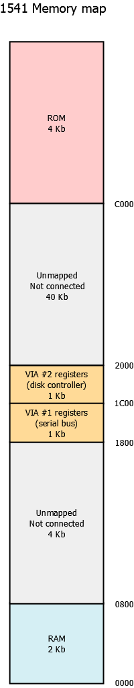
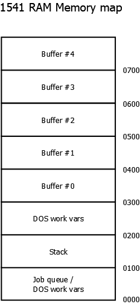
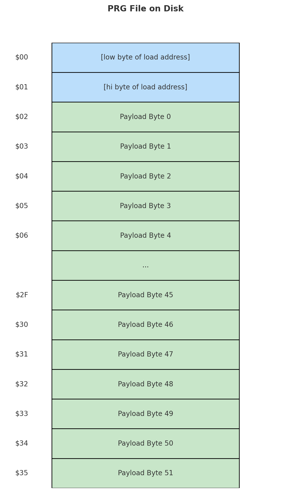
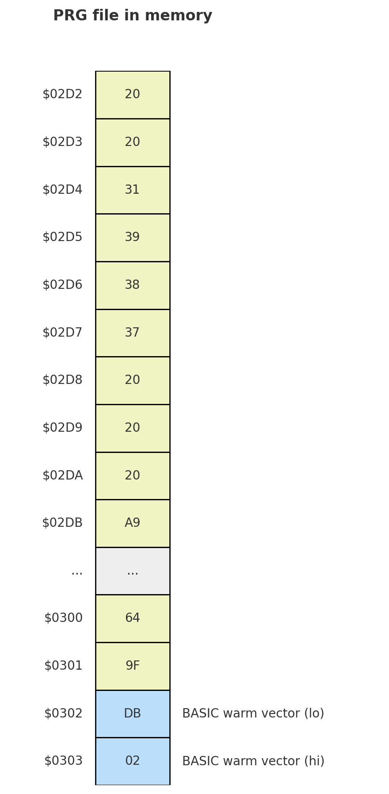
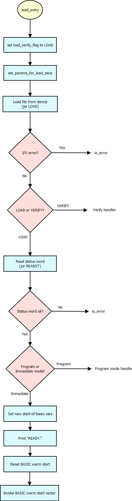
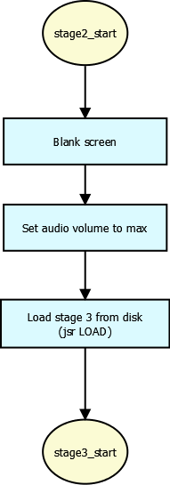

# The C64 boot loader

When a Commodore 64 owner typed `LOAD` for Maniac Mansion, the program that came off the disk was
not the game. It was a chain of ten small programs, some running on the C64 and some inside the
disk drive, that loaded the game engine at high speed, checked that the disk was an original, and
decrypted the engine with keys that only an original disk produces. This folder documents that
chain, stage by stage, as commented 6502 assembly.

| File | What it is |
|---|---|
| [overview.txt](overview.txt) | A plain-language introduction, then a one-paragraph summary of each stage |
| [flow-of-execution.txt](flow-of-execution.txt) | The whole sequence as two columns, C64 and drive, step by step |
| `01-…` to `10-…` | One file per stage, in the order they run (table below) |
| [diagrams/](diagrams/) | Memory maps and flow charts, shown below |

None of this is needed to run the game in an interpreter; see
[the last section](#why-an-interpreter-does-not-need-the-loader).

## Background for readers who don't know the C64

**Two computers.** The Commodore 1541 disk drive is a computer in its own right: it has its own
6502 processor, 2 KB of RAM, a ROM holding the disk operating system ("DOS"), and two VIA
chips, one for the serial bus and one for the disk mechanism. The C64 does not read the disk
itself. It sends commands over a serial cable and the drive's CPU does the work, then sends the
bytes back. Because the drive runs programs, a C64 program can also upload code into the drive's
RAM and run it there. Several of the stages below do exactly that.

*The 1541's address space. Only the RAM at the bottom, the two VIA chips and the ROM at the top are
connected.*

*The drive's 2 KB of RAM. Programs uploaded by the loader run in the buffers (#0 at $0300 to #4 at
$0700); the job queue at the bottom is how code asks the drive's DOS to read or execute a sector.*

**Why a fast loader.** The standard C64 serial protocol, implemented in the C64's KERNAL ROM and
the drive's DOS, moves only a few hundred bytes a second, so loading tens of kilobytes takes minutes.
Commercial games replaced it with a *fast loader*: a pair of programs, one on each side of the
cable, that use their own tightly timed protocol. Here the drive sends two bits at a time on two
bus lines and the C64 samples them at fixed instruction counts, with interrupts off.

**Tracks, sectors and GCR.** A 1541 disk has 35 tracks of 17 to 21 sectors of 256 bytes. On the
surface each byte is written in GCR (group code recording), a 5-bits-for-4 code that keeps the
magnetic signal readable. The drive's ROM has routines to find a sector header, read the GCR data
and decode it, and the drive-side stages call those routines directly instead of going through the
DOS file layer.

**DOS commands.** The C64 talks to the drive's DOS by writing text to command channel 15. The
loader uses four:

- `M-W` (memory write): store bytes in drive RAM.
- `M-R` (memory read): fetch bytes from drive RAM.
- `B-E` (block execute): read a sector into a drive buffer and jump to it on the drive's CPU.
- `U1` (block read): read a sector raw, including its two link bytes, into a buffer the C64 can read.

**PRG files.** A C64 program file starts with a two-byte load address, followed by the bytes to put
there.

## The stages

| Stage | Runs on | What it does | File |
|---|---|---|---|
| 1 | C64 (loaded by the KERNAL) | A tiny program loaded at `$02D2`. It is long enough to run over the BASIC warm-start vector at `$0302`/`$0303` and replaces it with the address of stage 2. When `LOAD` finishes and BASIC returns to its prompt through that vector, stage 2 runs instead. Nothing has to be typed after `LOAD`. | [01-c64-load-hijacking.txt](01-c64-load-hijacking.txt) |
| 2 | C64 | Blanks the screen, sets the sound volume, and uses the normal KERNAL `LOAD` to load the next file (named `"  1987   "`) to `$9C00`, then jumps to it. | [02-c64-autoloader.txt](02-c64-autoloader.txt) |
| 3 | C64 | Opens the command channel, writes a sentinel byte into drive RAM with `M-W`, and sends `B-E` to make the drive load track 18 sector 11 into buffer #2 and run it. Copies the transfer parameters (152 full sectors, load address `$03FC`, 52 bytes in the last sector) to `$9C00` and calls the receiver. | [03-c64-drive-configurator.txt](03-c64-drive-configurator.txt) |
| 4 | Drive | Reads track 18 sector 12 into buffer #0 with the ROM's block-read routine, checks the sentinel, fingerprints the drive ROM, and enters the job loop held in that sector. | [04-drive-load-job-setup.txt](04-drive-load-job-setup.txt) |
| 5 | Drive | The fast sender. For each sector: wait for sync, match the header, read and GCR-decode the data, verify the checksum, and stream the bytes to the C64 two bits at a time. The first two bytes of each sector name the next track and sector; a track change ends the job and starts a new one on the next track. | [05-drive-fast-send.txt](05-drive-fast-send.txt) |
| 6 | C64 | The fast receiver. Interrupts off, samples the bus lines and assembles bytes into memory from `$0400` upward, skipping each sector's link bytes, until the last sector's byte count. The result is the main file, about 38 KB at `$0400`–`$9B04`. | [06-c64-fast-receive.txt](06-c64-fast-receive.txt) |
| 7 | C64 | Decrypts the rest of the loader (`$9D20`–`$9F63`, which holds stages 8 and 10) with a simple XOR stream whose key grows by a constant each byte. Pushes a return address so that a later `RTS` lands at `$0400`, then jumps to stage 8. | [07-c64-decryptor.txt](07-c64-decryptor.txt) |
| 8 | C64 | The integrity checks: reads track 18 sector 8 raw with `U1` and XORs its bytes; has the drive execute that same sector with `B-E` (stage 9) and reads the result byte back with `M-R`; XOR-checksums the code of the game-code decryptor (stage 10). Then calls stage 10, and afterwards wipes the decrypted loader code from memory. | [08-c64-integrity-checks.txt](08-c64-integrity-checks.txt) |
| 9 | Drive | The copy protection. Decrypts its own body, then steps the head to track 35, half a track further to 35.5, and to 36, trying to read every sector at each position. Only if every read succeeds does it write `$FF` to drive address `$01FF`, which stage 8 reads. It then parks the head and erases itself. | [09-drive-copy-protection-check.txt](09-drive-copy-protection-check.txt) |
| 10 | C64 | Decrypts the first 4 KB of the engine (`$0400`–`$13FF`) in place with a rolling XOR whose three-byte state is seeded from the results of stage 8 and a checksum of stage 8's own code. Returns to stage 8, whose final `RTS` goes to `$0400`. | [10-c64-game-code-decryptor.txt](10-c64-game-code-decryptor.txt) |

[flow-of-execution.txt](flow-of-execution.txt) shows the same sequence with the two processors side
by side, which makes the hand-offs over the cable easier to follow.

### Stage 1 and the warm-start vector

*The stage 1 file as stored: a two-byte load address, then the payload.*

*The same file after loading at `$02D2`. Payload bytes `$30` and `$31` land on `$0302`/`$0303`,
the vector BASIC jumps through after a load, and point it at `$02DB`, the start of stage 2.*

*What the C64's ROM does after a `LOAD` typed at the prompt. Every step is normal ROM code; the
last box, "invoke BASIC warm start vector", is where control passes to the loader.*

### Stages 2 and 3

*Stage 2 is a plain KERNAL load of the next file.*

*Stage 3 starts the drive-side loader and then waits in the fast receiver; from here the two
processors run in parallel.*

## Copy protection, encryption and integrity checks

The loader combines four checks, and none of them simply branches to "copy detected". Each produces
a byte, and the bytes become part of the decryption key for the engine.

1. **The protection sector.** Track 18 sector 8 is both data and drive code. Its first 192 bytes
   are read raw with `U1` and XORed together (stage 8). A disk with a different sector 8 gives a
   different byte.
2. **The half-track sweep.** The same sector, run on the drive with `B-E` (stage 9), reads track 35,
   the half-track position 35.5 and track 36. Standard DOS formats only 35 tracks and never
   positions the head between tracks, and ordinary copiers of the time copied only what DOS could
   read, so a copy is likely to give a read error somewhere in the sweep. The result is a single
   byte in drive RAM, `$FF` for a pass, read back with `M-R` and inverted to `$00`.
3. **Self-checksums.** Stage 8 XORs the code of the decryptor (stage 10), and stage 10 XORs stage
   8's code and patches the result into one of its own instructions as an immediate operand.
   Changing the loader, for example to skip a check, changes these bytes.
4. **Drive fingerprint and sentinel.** Stage 4 checks a byte of the drive ROM and a sentinel value
   that stage 3 wrote into drive RAM; the fast sender (stage 5) checks the sentinel again before it
   finishes, and resets the drive if it does not match.

The engine itself is stored encrypted. Stage 7 decrypts the remaining loader code with a fixed key.
Stage 10 decrypts `$0400`–`$13FF`, the start of the engine, with a three-byte state seeded from
checks 1 to 3: the sector checksum plus the drive's result, the decryptor checksum minus the drive's
result, and the checksum of stage 8. If any check gives the wrong byte, decryption still runs to
completion, but it produces garbage, and the jump to `$0400` runs that garbage. Afterwards stage 8 overwrites the loader's decrypted code with zeroes,
so the keys and the decryptor are no longer in memory once the game runs.

## Hand-off to the engine

The loader ends with an `RTS` that lands at `$0400`, the engine's entry point `game_code_entry` in
[`../c64-engine/system/entry_point.asm`](../c64-engine/system/entry_point.asm). The engine sets up
the stack, video and memory map, initialises its subsystems, and clears its heap (`$7B7B` to
`$C800`), overwriting what is left of the loader. It then starts global script 1, the first of the
game's [scripts](../scripts/README.md).

The engine does not keep the loader's drive code. During initialisation
[`../c64-engine/disk/drive_setup.asm`](../c64-engine/disk/drive_setup.asm) uploads its own 512-byte
program into the drive with `M-W` and starts it with `U3`. From then on all disk access goes
through that program and the engine's own serial routines in [`../c64-engine/disk/`](../c64-engine/disk/):
[`disk_low_level.asm`](../c64-engine/disk/disk_low_level.asm) for the byte-level protocol and
[`disk_high_level.asm`](../c64-engine/disk/disk_high_level.asm) for reading and writing sectors by
track and sector. Rooms, scripts, costumes and sounds are found through the index at the start of
disk 1 and read by track and sector, not by file name, and they are not encrypted. Saving a game
writes sectors the same way.

## Why an interpreter does not need the loader

Everything the loader does serves to put the *engine* into the C64's memory: the fast transfer, the
protection and the decryption all concern the program code at `$0400`. An interpreter replaces that
program. What it needs from the disk is the *game data*, which the engine reads itself, unencrypted,
by track and sector.

A `.d64` image holds exactly what that requires. It is the decoded 256-byte contents of every sector
of tracks 1 to 35 in order, 683 sectors or 174,848 bytes. It has no GCR, no half-tracks and no
track 36, so the copy protection cannot even be represented in it; it does not matter, because
nothing outside the loader looks at those.

ScummVM reads the images this way, in `ScummDiskImage` (`engines/scumm/file.cpp`):

- It opens `maniac1.d64` and `maniac2.d64` (or `maniacdemo.d64` for the demo) and checks the
  signature at the start of each: `0x0A31` on disk 1, `0x0132` on disk 2.
- `extractIndex` reads the index from the start of disk 1: 256 object bytes, then for 55 rooms the
  disk number and the sector and track, then the costume, script and sound tables (160 scripts and
  70 sounds in the retail game, 55 and 40 in the demo).
- `extractResource` turns a room's track and sector into a file offset with the `C64SectorOffset`
  table, `(C64SectorOffset[track] + sector) * 256`, opens the right disk, and copies out the room's
  resources, each prefixed by its 16-bit length. The number of resources per room comes from the
  built-in tables `maniacResourcesPerFile` and `maniacDemoResourcesPerFile`.
- It hands the result to the rest of the engine as if it were the DOS release's `00.LFL` (the
  index) and `NN.LFL` (room *NN*) files, XOR-encoding each byte with `0xFF` as those files are, and
  rewriting the index signature to `0x0132` so the version 0 index reader recognises it.

No loader stage is executed, emulated or even read. The layout of the index and the room data is
described in more detail in [the scripts README](../scripts/README.md#where-the-scripts-are-on-the-disk)
and [../scripts/c64-disk-layout.txt](../scripts/c64-disk-layout.txt).
